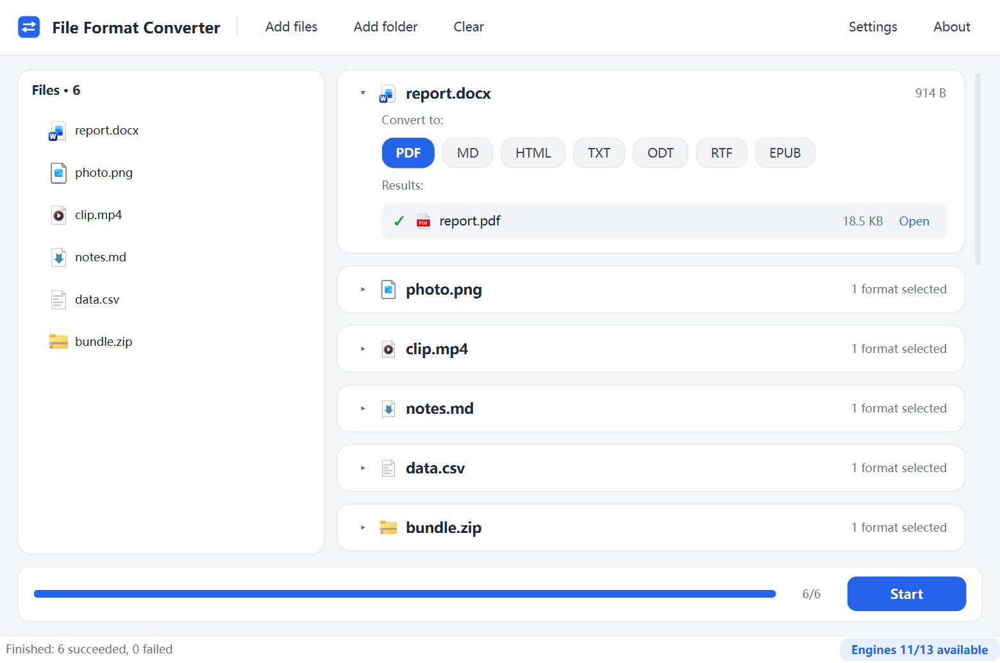

# File Format Converter

[中文说明](README.zh-CN.md)

A small, minimal drag & drop file converter. Drop files or whole folders into
the window, tick the formats you want, and convert. One source file can be
converted to several formats at once, and any number of files can be processed
in one run.



## Features

- Drag & drop files or folders anywhere in the window
- One collapsible card per file, with a list of valid target formats as chips
- Multi-select targets: `photo.jpg` + `PNG` + `PDF` produces both files
- Real format detection from file signatures, so renamed files still convert
  correctly
- Results show the actual output file icon, size and an "open folder" button
- Word, Excel and PowerPoint documents convert through the installed Microsoft
  Office; PDF files can be turned into Word, text or page images
- Pandoc handles Markdown / HTML / text ↔ docx / odt / rtf / epub, and Tesseract
  OCR reads scanned PDFs into text
- Batch conversion with one overall progress bar; a failed file does not stop
  the others
- Chinese / English UI, remembered between runs
- Light / dark / follow-system themes
- Engine status bar: built-in engines plus installed Office applications,
  Pandoc, Tesseract OCR and optional LibreOffice / Calibre are detected

## Supported conversions

| Source | Targets | Engine |
| --- | --- | --- |
| `jpg` `png` `webp` `bmp` `gif` `tiff` `ico` `ppm` | each other, plus `pdf` (quality setting for JPG/WEBP) | Pillow + pillow-heif |
| `heic` | any of the formats above | Pillow + pillow-heif |
| `mp4` `mkv` `avi` `mov` `webm` `flv` `wmv` `m4v` `ts` `mpg` | `mp4` `mkv` `webm` `avi` `mov` `gif` and audio `mp3` `wav` `flac` `aac` `m4a` `ogg` `opus` `wma` | FFmpeg |
| `mp3` `wav` `flac` `aac` `m4a` `ogg` `opus` `wma` | each other | FFmpeg |
| `zip` `7z` `tar` `tar.gz` `tar.bz2` `tar.xz` | `zip` `7z` `tar` `tar.gz` `tar.xz` | stdlib + py7zr |
| `txt` `md` `html` | each other | Markdown, BeautifulSoup, markdownify |
| `csv` `xlsx` | each other | openpyxl |
| `docx` `doc` `odt` `rtf` | `pdf` | Microsoft Word (COM) |
| `xlsx` `xls` | `pdf`; `xls` also to `xlsx` | Microsoft Excel (COM) |
| `pptx` `ppt` | `pdf` | Microsoft PowerPoint (COM) |
| `pdf` | `docx` (Word), `txt`, `png` / `jpg` (a ZIP of page images) | Word, pypdf, pypdfium2 |
| `docx` `odt` `rtf` `epub` `md` `html` `txt` | `md` `html` `txt` `docx` `odt` `rtf` `epub` (except the source format) | Pandoc |

Office conversions use the copy of Microsoft Office that is already installed
on the machine; Office is never bundled. PDF page images are rendered at about
144 DPI and delivered as one ZIP per PDF. Office-based targets are Windows-only
and are hidden on macOS/Linux.

PDF → TXT automatically falls back to Tesseract OCR when a PDF has no text layer
(a scanned document). Chinese and English OCR data is bundled with the app; the
Tesseract program itself must be installed.

Video/audio conversions are re-encodes. A single file can be converted to
several formats at once; each format is an independent job.

## Download

Grab the latest release, unzip it anywhere and run
`FileFormatConverter.exe`. The release package includes the FFmpeg LGPL build and
Chinese/English OCR data, so media conversion and OCR work without extra data
files. Word/Excel/PowerPoint formats require Microsoft Office on that computer;
Pandoc-based formats require Pandoc; OCR requires Tesseract. Missing tools are
greyed out automatically.

## Run from source

Requirements: Python 3.10+ (Windows, macOS or Linux).

```bash
git clone https://github.com/fwhhhh/file-format-converter.git
cd file-format-converter
python -m venv .venv
# Windows
.venv\Scripts\activate
# macOS / Linux
source .venv/bin/activate

pip install -r requirements-dev.txt
python scripts/download_deps.py   # Windows: fetch FFmpeg into vendor/ffmpeg
python run.py
```

On macOS or Linux, install ffmpeg with `brew install ffmpeg` or
`sudo apt install ffmpeg` instead of running `download_deps.py`.

### Optional document tools

The app calls these tools when they are installed; it never bundles them.

```bash
winget install JohnMacFarlane.Pandoc      # docx/odt/epub ↔ md/html/txt
winget install UB-Mannheim.TesseractOCR   # OCR for scanned PDFs
```

On macOS/Linux use `brew install pandoc tesseract` or the equivalent package.
The Chinese and English OCR language data is already bundled in the project.

## Build a portable package

```bash
python scripts/make_icon.py
python scripts/build.py
```

The result is `dist/FileFormatConverter/`. Zip that folder and it can be copied
to another Windows computer and started directly. The build script bundles
`vendor/ffmpeg`, the license notices and the application icon.

## Test

```bash
python -m pytest
```

The suite covers format sniffing, every engine, and a GUI smoke test with the
offscreen Qt platform.

To verify a built package on another machine, run:

```bash
FileFormatConverter.exe --selftest
```

It writes `selftest.txt` next to the executable with one line per conversion,
so you can confirm that Pillow, HEIC, 7z, openpyxl and FFmpeg all work there.

## Project layout

```
app/
  main.py            entry point
  i18n.py            Chinese / English strings
  settings.py        QSettings wrapper
  core/              detection, models, job scheduling, helpers
  engines/           office / pdf / pandoc / image / media / archive / text / table
  ui/                main window, file cards, dialogs, theme
scripts/             dependency download, icon, screenshots
tests/               pytest suite
vendor/              FFmpeg binaries (downloaded, not tracked by git)
```

## Known limitations

- PDF → Word uses Word's PDF reflow. Text-based PDFs convert well; scanned PDFs
  have no text layer and are converted as page images (PDF → TXT does use OCR).
- Office conversions require Microsoft Office installed on the machine. The app
  never bundles Office. LibreOffice as a free fallback is planned.
- Pandoc is required for Markdown/HTML/text ↔ docx/odt/rtf/epub conversions;
  Tesseract is required for OCR.
- `epub`/`odt`/`rtf` are supported through Pandoc; `mobi`/`azw3` and Calibre
  conversions are not wired up yet.
- Password-protected archives are rejected.
- GIF output is a re-encoded animation; expect a larger file than a video.
- XLSX to CSV converts the active worksheet only.
- PDF → PNG / JPG returns one ZIP per PDF containing all pages; docx → Markdown
  may create a `<name>_media` folder for embedded images.

## License

MIT. FFmpeg is invoked as a separate executable and is distributed under the
LGPL; see [docs/THIRD_PARTY.md](docs/THIRD_PARTY.md).
