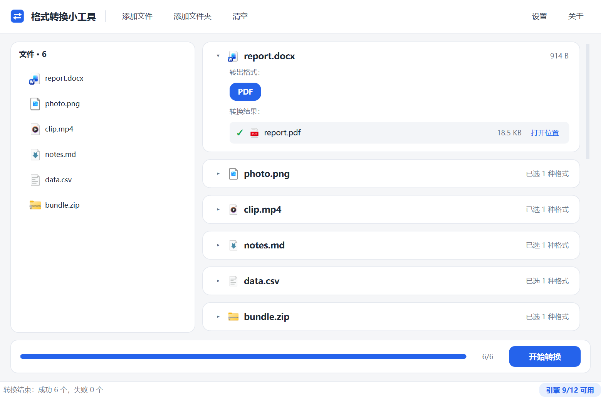

# 格式转换小工具

[English](README.md)

一个极简的拖拽式文件格式转换工具。把文件或整个文件夹拖进窗口，勾选要转出的格式，点开始转换即可。一个文件可以同时转出多种格式，也可以一次转换多个文件。



## 功能

- 窗口任意位置都能拖入文件或文件夹
- 每个文件一张可折叠卡片，目标格式以圆角标签展示
- 支持多选目标格式：`photo.jpg` 勾选 `PNG` 和 `PDF`，会同时得到两个文件
- 按文件头识别真实格式，改了后缀的文件也能正确转换
- 转换完成后显示产物图标、实际大小，并可一键打开所在文件夹
- Word / Excel / PowerPoint 文档通过本机已安装的 Microsoft Office 转换；PDF 可转 Word、文本或逐页图片
- 批量转换只有一个总进度条；某个文件失败不影响其它文件
- 中文 / English 界面，记住上次选择
- 浅色 / 深色 / 跟随系统三种主题
- 底部引擎状态：内置引擎、已安装的 Office 组件，以及可选的 Pandoc / LibreOffice / Calibre 都会检测并显示

## 支持的转换

| 源格式 | 目标格式 | 引擎 |
| --- | --- | --- |
| `jpg` `png` `webp` `bmp` `gif` `tiff` `ico` `ppm` | 互相转换，另可转 `pdf`（JPG/WEBP 可调质量） | Pillow + pillow-heif |
| `heic` | 上述任意格式 | Pillow + pillow-heif |
| `mp4` `mkv` `avi` `mov` `webm` `flv` `wmv` `m4v` `ts` `mpg` | `mp4` `mkv` `webm` `avi` `mov` `gif`，以及音频 `mp3` `wav` `flac` `aac` `m4a` `ogg` `opus` `wma` | FFmpeg |
| `mp3` `wav` `flac` `aac` `m4a` `ogg` `opus` `wma` | 互相转换 | FFmpeg |
| `zip` `7z` `tar` `tar.gz` `tar.bz2` `tar.xz` | `zip` `7z` `tar` `tar.gz` `tar.xz` | 标准库 + py7zr |
| `txt` `md` `html` | 互相转换 | Markdown、BeautifulSoup、markdownify |
| `csv` `xlsx` | 互相转换 | openpyxl |
| `docx` `doc` `odt` `rtf` | `pdf` | Microsoft Word（COM） |
| `xlsx` `xls` | `pdf`；`xls` 还可转 `xlsx` | Microsoft Excel（COM） |
| `pptx` `ppt` | `pdf` | Microsoft PowerPoint（COM） |
| `pdf` | `docx`（Word）、`txt`、`png` / `jpg`（逐页图片打包为 ZIP） | Word、pypdf、pypdfium2 |

Office 转换调用的是电脑上已安装的 Microsoft Office，程序不会打包 Office。PDF 转图片按约 144 DPI 渲染，每份 PDF 输出一个包含全部页面的 ZIP。基于 Office 的转换仅在 Windows 上可用，macOS / Linux 上会自动隐藏这些目标格式。

音视频互转都是重新编码；同一个文件勾选多个格式时，每个格式是独立的任务。

## 下载

到 Releases 下载最新压缩包，解压后双击 `FileFormatConverter.exe` 即可。发布包内置 FFmpeg（LGPL 构建），音视频转换不需要额外安装或配置 PATH。Word / Excel / PowerPoint 格式需要电脑上装有 Microsoft Office，没装时对应格式会灰显。

## 从源码运行

需要 Python 3.10+（Windows / macOS / Linux）。

```bash
git clone https://github.com/fwhhhh/file-format-converter.git
cd file-format-converter
python -m venv .venv
# Windows
.venv\Scripts\activate
# macOS / Linux
source .venv/bin/activate

pip install -r requirements-dev.txt
python scripts/download_deps.py   # 仅 Windows：下载 FFmpeg 到 vendor/ffmpeg
python run.py
```

macOS / Linux 用户请用 `brew install ffmpeg` 或 `sudo apt install ffmpeg` 安装 FFmpeg，无需运行下载脚本。

## 打包成绿色版

```bash
python scripts/make_icon.py
python scripts/build.py
```

输出在 `dist/FileFormatConverter/`，整个文件夹压缩后拷到别的 Windows 电脑上即可直接运行。打包脚本会自动带上 `vendor/ffmpeg`、许可证说明和应用图标。

## 测试

```bash
python -m pytest
```

测试覆盖格式识别、全部转换引擎，以及使用离屏 Qt 平台的界面冒烟测试。

验证打包后的程序是否在别的电脑上可用：

```bash
FileFormatConverter.exe --selftest
```

它会在 exe 旁边生成 `selftest.txt`，逐个列出转换结果，可确认 Pillow、HEIC、7z、openpyxl 与 FFmpeg 均正常。

## 目录结构

```
app/
  main.py            入口
  i18n.py            中英文案
  settings.py        QSettings 封装
  core/              格式识别、数据模型、任务调度、工具函数
  engines/           Office / PDF / 图片 / 音视频 / 压缩包 / 文本 / 表格转换引擎
  ui/                主窗口、文件卡片、对话框、主题
scripts/             依赖下载、图标、截图脚本
tests/               pytest 测试
vendor/              FFmpeg 可执行文件（下载所得，不进入 git）
```

## 已知限制

- PDF → Word 使用 Word 的 PDF 重排功能：有文字层的数字化 PDF 效果好；扫描版 PDF 没有文字层，需要 OCR（暂未内置）。
- Office 转换要求本机安装 Microsoft Office，程序不会内置 Office；免费备选 LibreOffice 计划后续接入。
- 电子书（`epub`、`mobi`、`azw3`）和 Pandoc 系格式（`odt` ↔ `md` 等）目前只做检测，尚未接入转换。
- 不支持加密压缩包。
- GIF 输出是重新编码的动画，体积会比视频大。
- XLSX 转 CSV 只转换当前工作表。
- PDF 转 PNG / JPG 每份 PDF 输出一个包含全部页面的 ZIP。

## 开源协议

MIT。FFmpeg 以独立可执行文件的方式调用，遵循 LGPL；详见 [docs/THIRD_PARTY.md](docs/THIRD_PARTY.md)。
